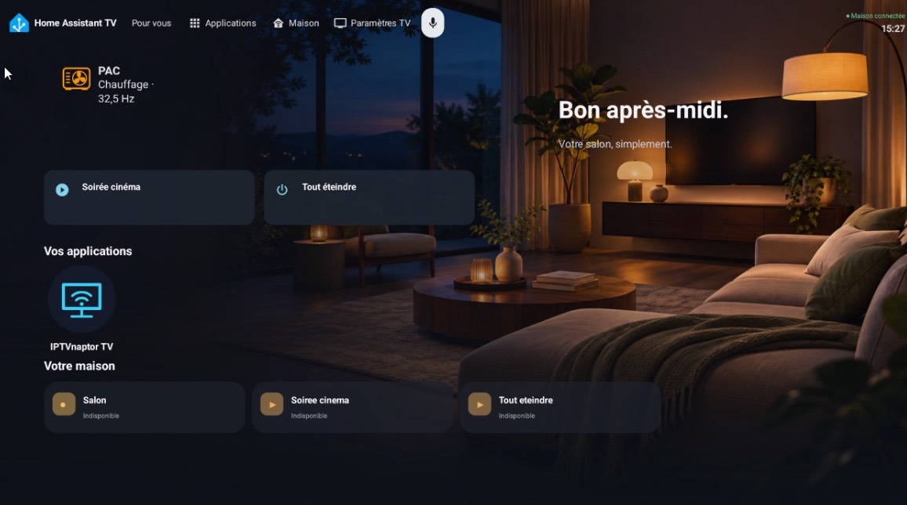
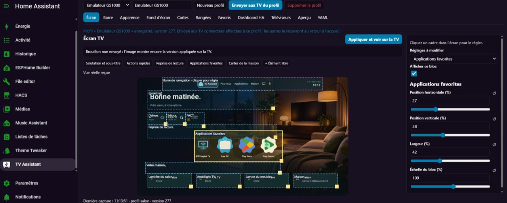
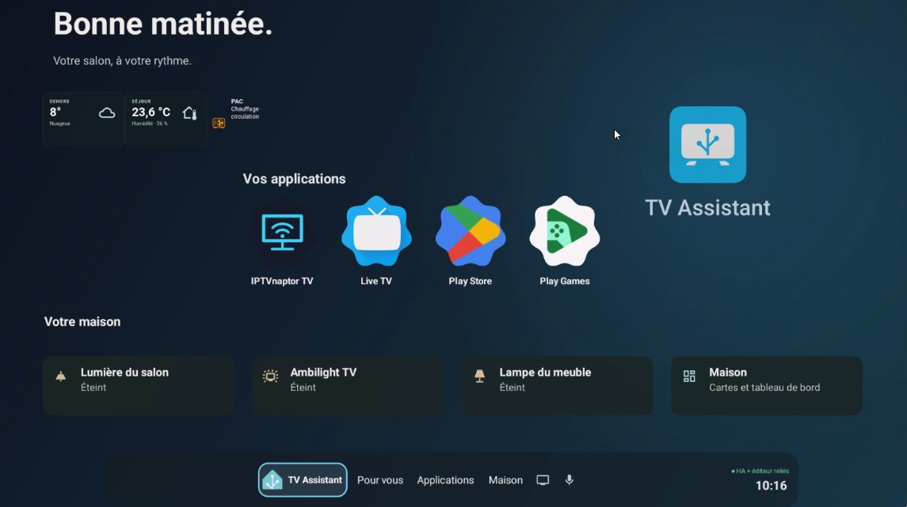
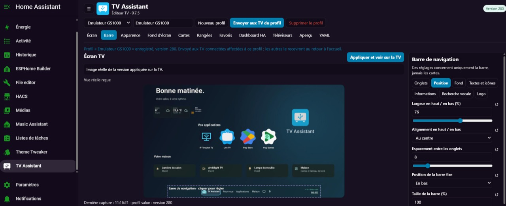
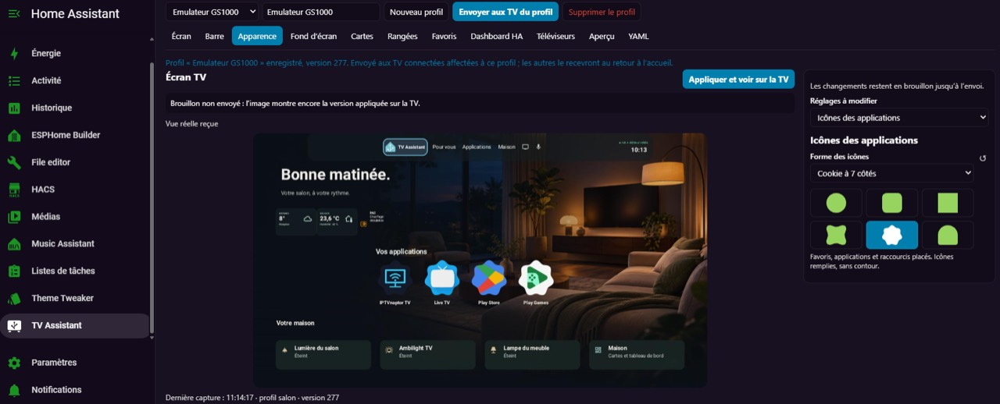

# TV Assistant

[English](docs/README.en.md) · [Installation](docs/INSTALLATION.md) · [Télécharger l’APK](https://github.com/Philiphall6/tv-assistant/releases) · [Sécurité](SECURITY.md)

Un launcher Android TV personnalisable et un éditeur multi-TV dans Home Assistant. Projet communautaire indépendant, sans affiliation officielle avec Home Assistant ou Google.

## Aperçu

### Accueil sur la TV

Un exemple de disposition personnalisée : les informations de la maison, vos applications et les commandes restent sur le même écran.

### Éditeur dans Home Assistant

Déplacez et redimensionnez les éléments depuis Home Assistant. L’aperçu réel montre la disposition appliquée sur la TV ; les modifications restent en brouillon jusqu’à l’envoi.

Voir les variantes et les réglages de personnalisation

### Fond TV Assistant et barre en bas

### Position et largeur de la barre

### Forme des icônes

Captures fournies et autorisées pour publication par le propriétaire du projet. Elles montrent un exemple personnalisé, pas la configuration par défaut : les libellés, applications, cartes et valeurs visibles dépendent de votre installation. Les métadonnées des fichiers ont été retirées ; aucun profil ni identifiant d’entité n’est fourni avec ces images.

## Compatibilité

- Android **11 à 16** (API 30 à 36), télécommande directionnelle et écran paysage. Android 9 et 10 ne sont pas pris en charge.
- Home Assistant **2026.10.4 ou supérieur** pour l’intégration. Android System WebView doit être à jour pour les vraies cartes Lovelace.
- Connexion Home Assistant **HTTPS avec certificat valide** obligatoire. Les certificats non valides et les connexions HTTP sont refusés.
- Le choix du launcher par défaut dépend du fabricant. L’application ne désactive jamais automatiquement le launcher système.

**Amazon Fire TV :** les adaptations de l’[APK expérimental 2.13.9 — bêta 1](https://github.com/Philiphall6/tv-assistant/releases/tag/firetv-2.13.9-beta.1) sont conservées dans l’APK 2.14.0, mais Fire OS reste expérimental (API Android 30 minimum). Lire le [guide et les limites](docs/FIRE_TV.md) avant installation. Aucun Fire TV réel n’a été validé. Vega OS est exclu ; le remplacement de l’accueil Amazon et les superpositions ne sont pas garantis.

## Fonctions

- Applications favorites, formes d’icônes, appui long, reprise de lecture avec images et progression lorsqu’une application fournit ces données.
- Raccourcis de télécommande et association locale d’une touche à une application, dans les limites imposées par le fabricant.
- Barre configurable : position, dimensions, onglets, couleurs, horloge, statut et recherche vocale.
- Cartes natives, placement libre, éditeur visuel et YAML dans HA, profils partagés ou différents par TV.
- Cartes Lovelace réelles dans une surface WebView persistante, ressources fournies par votre HA, sans rechargement périodique de la page. Pointeur télécommande pour les cartes interactives.
- Fonds unis, image locale, album Google Photos partagé avec cache et synchronisation. Cette dernière fonction dépend du format des albums publics Google et peut nécessiter des adaptations.
- Respect de l’économiseur d’écran système après inactivité, sans modifier les albums Google ni les délais configurés sur la TV.
- Notifications HA facultatives au-dessus des applications : aucun réveil, aucune notification en veille et aucun rattrapage à l’allumage. [Configuration et limites](docs/INSTALLATION.md#notifications-home-assistant).
- Vérification manuelle des mises à jour de l’APK, option quotidienne désactivée par défaut, et diagnostic technique consultable avant partage.
- Fond intégré TV Assistant sur les nouvelles installations ; les fonds existants sont conservés.
- Onglet Applications : taille des icônes et des noms, applications par rangée et rangées visibles, indépendamment des favoris de l’accueil.

L’aperçu réel nécessite que le launcher soit ouvert sur la TV. Un schéma de placement reste disponible pour organiser la disposition ; ce n’est pas une fausse capture en direct. Les cartes personnalisées nécessitent leurs extensions installées dans HA et ne sont pas toutes garanties compatibles avec une télécommande.

## Installation

TV Assistant est disponible dans le **catalogue HACS par défaut**. [HACS doit déjà être installé et configuré](https://www.hacs.xyz/docs/use/).

1. Cliquer sur [**Installer avec HACS**](https://my.home-assistant.io/redirect/hacs_repository/?owner=Philiphall6&repository=tv-assistant&category=integration), ou rechercher **TV Assistant** directement dans HACS. Le bouton ouvre sa fiche dans votre Home Assistant ; si demandé, renseigner l’adresse de votre propre instance dans My Home Assistant.
2. Télécharger l’intégration, redémarrer HA à un moment approprié, puis ajouter **TV Assistant** dans **Paramètres → Appareils et services**.
3. Installer l’APK signé depuis les [versions publiées](https://github.com/Philiphall6/tv-assistant/releases). HACS installe l’intégration, **pas l’APK**.
4. Créer un utilisateur HA dédié à la TV, **non administrateur**, et son jeton longue durée. Le saisir uniquement dans les réglages locaux de la TV avec l’adresse HTTPS de HA.
5. Activer l’édition depuis HA sur la TV. Depuis votre compte administrateur habituel, ouvrir **TV Assistant**, créer un profil et l’attribuer explicitement à cette TV après vérification de son identifiant.

**Solution de secours :** si TV Assistant n’apparaît pas encore dans votre recherche HACS, aller dans le menu **Dépôts personnalisés**, ajouter `https://github.com/Philiphall6/tv-assistant` avec le type **Intégration**, puis reprendre à l’étape 2.

L’administrateur peut modifier toutes les TV ; leur utilisateur dédié reste non administrateur. Les nouvelles TV n’obtiennent aucun profil tant qu’elles ne sont pas approuvées par cette attribution.

Voir [installation et retour arrière](docs/INSTALLATION.md), [compilation et signature](docs/BUILD.md), [sécurité](SECURITY.md) et [validation](docs/TESTING.md).

Le bouton ne déclenche aucune installation automatique : le téléchargement et le redémarrage restent à confirmer par vous. Il ne contient aucune adresse personnelle ni aucun jeton.

## Langues

La TV utilise la langue d’Android ; le panneau utilise la langue du compte Home Assistant, même si le navigateur est dans une autre langue. Français et anglais sont fournis, avec l’anglais comme langue de repli. Les noms personnalisés, les profils, les entités et le YAML ne sont pas traduits ni réécrits.

Les dates et nombres suivent les paramètres régionaux. L’horloge suit le format 12/24 heures d’Android. La langue de reconnaissance vocale vaut `auto` par défaut ; un choix explicite comme `fr` ou `en` reste prioritaire. Les anciennes configurations avec une langue explicite sont conservées. Les cartes Lovelace utilisent les traductions fournies par HA et leurs propres extensions ; certains diagnostics techniques peuvent conserver leur langue d’origine.

## Mise à jour et données

Dans les paramètres du launcher, **Mises à jour et diagnostic** permet de vérifier la dernière publication stable et d’ouvrir sa page officielle. Le numéro de l’APK est comparé, pas celui de l’intégration HACS. Aucune installation automatique : télécharger l’APK signé puis l’installer en conservant la même signature. La vérification automatique, facultative, se fait au retour à l’accueil au maximum une fois par jour, sans réveiller la TV. GitHub reçoit l’adresse IP de connexion, mais aucun jeton HA ni identifiant de TV.

Le diagnostic est généré localement à partir d’une liste fermée d’informations techniques. Le contenu exact est affiché avant **Partager**, **Enregistrer** ou **Copier** ; aucun envoi automatique. Il ne contient ni journaux bruts, noms d’appareils, identifiants, URL, jetons, profils, photos ou historique. L’état HA correspond au dernier état observé sur l’accueil, pas à un nouveau test réseau.

Les réglages de la grille sont dans **Applications et favoris → Icônes, favoris et grille des applications**, ou **Rangées** dans l’éditeur HA. Les grandes icônes s’adaptent à leur cellule : réduire les colonnes ou rangées permet de les agrandir davantage. Dans **Fond d’écran**, choisir **TV Assistant** pour appliquer le nouveau fond à une installation existante.

Les paramètres locaux sont regroupés en **Accueil**, **Barre**, **Applications**, **Cartes**, **Fond**, **Connexion HA**, **Notifications**, **Télécommande et démarrage** et **Système et maintenance**. Les mises à jour et le diagnostic sont dans cette dernière rubrique ; les préférences existantes sont conservées.

L’APK utilise le même identifiant technique `fr.maison.tvlauncher`, pour préserver les mises à jour des installations précédentes lorsque la signature correspond. Le domaine HA reste `home_assistant_tv` pour la même raison. Ces noms techniques ne sont pas des données personnelles.

Les anciens jetons sont migrés vers Android Keystore lors de leur lecture avec une adresse HTTPS valide. Les réglages locaux et jetons ne sont pas exportés dans les profils HA. Une nouvelle TV ou une réinstallation après désinstallation nécessite de ressaisir son jeton ; aucune sauvegarde Android des données de l’application n’est autorisée.

Le dépôt ne contient ni jeton, clé de signature, fichier de configuration domestique, lien d’album personnel, ni ancien historique privé. Les exemples et tests utilisent des données fictives ; les captures de démonstration ci-dessus ont été expressément autorisées pour publication.

## Licence

Code original sous **GPL-3.0-only** : [LICENSE](LICENSE). Les bibliothèques et marques conservent leurs licences et droits respectifs : [THIRD_PARTY.md](THIRD_PARTY.md). Les noms et logos Home Assistant et Google ne sont pas couverts par la licence GPL de ce projet.

Pour contribuer : [guide de contribution](CONTRIBUTING.md), [traductions](docs/LOCALIZATION.md) et [catalogue HACS et validations](docs/HACS_DEFAULT.md).
