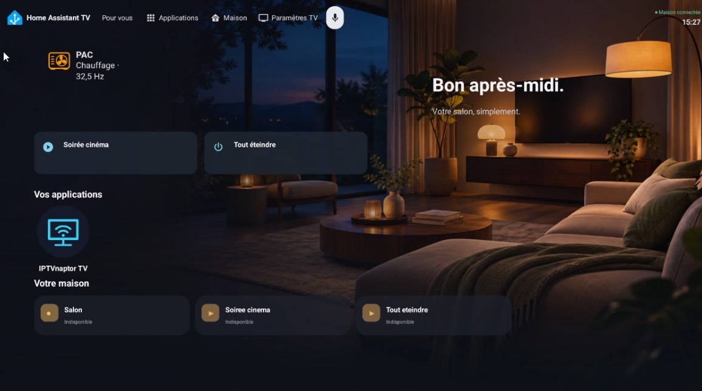
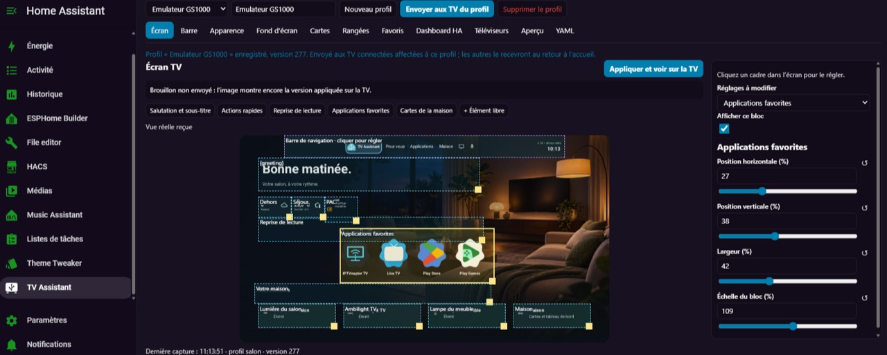

# TV Assistant

[Français](../README.md) · [Releases and signed APK](https://github.com/Philiphall6/tv-assistant/releases) · [Security](../SECURITY.md)

TV Assistant combines a customizable Android TV launcher with a multi-TV editor inside Home Assistant. It is an independent community project, not an official Home Assistant or Google product.

## Preview

These owner-approved screenshots show an earlier version called Home Assistant TV. File metadata has been removed. Your apps, cards and labels depend on your configuration.

## Requirements

| Component | Requirement |
| --- | --- |
| TV | Android 11–16, API 30–36 |
| Home Assistant | 2026.10.4 or newer |
| Connection | HTTPS with a valid certificate |
| Lovelace cards | Current Android System WebView and required HA card extensions |

Android 9 and 10 are not supported. Default-home behavior varies by manufacturer. The launcher never disables the system launcher automatically.

## Installation

TV Assistant is available in the **default HACS catalog**. [HACS must already be installed and configured](https://www.hacs.xyz/docs/use/).

1. Click [**Install with HACS**](https://my.home-assistant.io/redirect/hacs_repository/?owner=Philiphall6&repository=tv-assistant&category=integration), or search for **TV Assistant** directly in HACS. The button opens its repository page in your Home Assistant; if prompted, enter your own instance address in My Home Assistant.
2. Download the integration, restart HA at a suitable time, then add **TV Assistant** in **Settings → Devices & services**.
3. Install the signed APK from [Releases](https://github.com/Philiphall6/tv-assistant/releases) on the TV. HACS installs the integration, **not the APK**.
4. Create a dedicated, non-administrator HA user for the TV and a long-lived access token. Enter the HTTPS address and token only in the TV's local settings.
5. Enable editing from HA on the TV. In your administrator account, open **TV Assistant**, create a profile and explicitly assign it to the TV after checking its identity.

**Fallback:** if TV Assistant does not appear in your HACS search yet, open the **Custom repositories** menu, add `https://github.com/Philiphall6/tv-assistant` with type **Integration**, then continue from step 2.

New TVs cannot read a profile before an administrator assigns one. One profile can serve multiple TVs, or each TV can have a separate profile. See the [installation and rollback guide](INSTALLATION.md) for default-home setup and optional permissions.

The button does not install anything automatically: you still confirm the download and restart. It contains no personal address or token.

## Features and limits

- Favorite apps, configurable icon shapes, long-press menus and resume content with artwork and progress when apps provide it.
- Remote shortcuts and local button-to-app assignments, subject to manufacturer restrictions.
- Adjustable navigation position, size, tabs, colors, clock, status and voice search.
- Native cards, visual and YAML editing, free placement and shared or individual TV profiles.
- Real Lovelace cards in a persistent WebView, with remote-pointer interaction and no periodic page reload.
- Solid colors, a local image or a cached slideshow from a shared Google Photos album.
- The idle launcher and HA dashboard allow the system screensaver without changing Google albums or the TV's timeout settings.
- Manual APK update checks, optional daily checks (off by default), and privacy-safe technical diagnostics previewed before sharing.
- Built-in TV Assistant wallpaper on new installations, without replacing existing wallpaper choices.
- Separate Apps tab settings for icon and label size, apps per row and visible rows; home favourites remain unchanged.

The real preview requires the launcher to be visible on the TV. Otherwise, a placement plan remains available. Not every custom HA card supports TV remotes. Google Photos synchronization uses the public album page format, which Google can change. Treat shared album URLs as private data.

## Automatic language

The TV follows Android's language; the HA panel follows the current user's Home Assistant language. French and English are included, with English as fallback. Switching languages never translates or rewrites custom names, profiles, entity IDs or YAML.

Dates, numbers and the 12/24-hour clock follow local settings. Voice recognition uses Android's language when set to `auto`; an explicit language remains unchanged. Lovelace cards use HA and their extensions' translations. Some technical diagnostics may retain their original language.

## Updates, security and contributions

Open **Settings → Updates and diagnostics** to check the latest stable release and open its official page. The APK version is compared, not the HACS version. No APK is automatically downloaded or installed. Optional daily checks run when returning to the home screen and never wake the TV. GitHub receives your connection's IP address but no HA token or TV identifier.

The diagnostic uses a closed list of technical facts, generated locally. Its exact contents are displayed before you choose Share, Save or Copy. There are no raw logs, names, identifiers, addresses, credentials, profiles, photos or playback history, and nothing is uploaded automatically. HA status is the last observed on the home screen, not a new connection test.

Adjust the Apps tab in **Apps and favourites → Apps layout** on the TV, or **Rows** in the HA editor. Large icons are bounded to their cells: use fewer rows or columns to allow larger sizes. Existing installations can select **TV Assistant** in Wallpaper settings.

Install updates over the existing APK when the signing certificate matches. Uninstalling erases local settings and credentials. Tokens are encrypted with Android Keystore and excluded from Android backups. The stable package ID is `fr.maison.tvlauncher`; the integration domain is `home_assistant_tv`.

See [build and signing](BUILD.md), [tests](TESTING.md), [contributions](../CONTRIBUTING.md), [translations](LOCALIZATION.md) and [HACS catalog and validation](HACS_DEFAULT.md). Report vulnerabilities using [private reporting](https://github.com/Philiphall6/tv-assistant/security/advisories/new), never a public issue containing credentials.

Original code is licensed under [GPL-3.0-only](../LICENSE). [Third-party licenses and trademarks](../THIRD_PARTY.md) remain separate.
